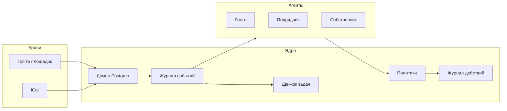

# Pomogaika — план по документам техлида

Источники истины:

- [product.md](product.md) — для кого, P0–P3, каналы, экономика, дорожная карта
- [architecture.md](architecture.md) — принципы, схема, сущности, события, политики, срезы MVP
- [contractors.md](contractors.md) — клинеры и мастера: свидетель, не судья
- [listings-and-pricing.md](listings-and-pricing.md) — витрины и цена, не MVP
- [../Pomogaika-product.pdf](../Pomogaika-product.pdf) — внешняя версия для собственников

Старый каркас (`ops/`, `src/`) удалён. Архив техлида: zip в корне репозитория.

Пилот: объект **KaVa**, Зеленоградск. Уже есть Авито и умный замок. Главная метрика: **часы собственника на одну бронь**.

## Принципы, которые не ломаем

Из architecture.md §1:

- Одно ядро, один журнал событий. Нет «у бота клинера своё состояние».
- Деньги и доступ — детерминизм и конечные автоматы. LLM только понимает текст и пишет текст.
- Политики как код: один вход `check(action, context)`. LLM вызывает инструмент, инструмент проверяет политику.
- Один агентный движок, три роли (гость / подрядчик / собственник): разные персоны, инструменты, автономия.
- Каналы через возможности (`can_initiate`, окно ответа, identity), не через названия мессенджеров.
- Мультитенантность с первого коммита: `owner_id` и `property_id` везде. База знаний объекта — в данных, не в промпте.
- Журнал действий неизменяемый: что / почему / кто разрешил.
- Копайлот по умолчанию. Автопилот — по классам действий из журнала.
- Провайдер LLM за абстракцией.

Не делаем в этом репозитории: юзерботы, MTProto чужих аккаунтов, computer use поверх мессенджеров, распознавание лиц, автоцены как функцию LLM.

## Стек

Пока команда не сказала иначе, фиксируем architecture.md §8 так:

- Python 3.12, FastAPI, SQLAlchemy, Alembic, Postgres
- На старте очередь: таблица outbox + воркер (Redis не обязателен)
- Telegram: aiogram 3; гости — Telegram Business (`business_connection_id`)
- Docker Compose, VPS в РФ
- LLM за интерфейсом провайдера. Тексты с ПДн: токены или российский провайдер — решить до фазы знакомых

## Модель данных с первого коммита

Не упрощать до «Property + Booking». Ключевые сущности из architecture.md §4:

- `Owner`, `Property` (timezone явно: Калининград UTC+2; knowledge структурированная)
- `Listing` (площадка, external_id, ical_url) — не путать с объектом
- `Booking` (`pending / confirmed / paid / cancelled`) + `Block` + `BookingConflict`
- `Stay` (код, checked_in_at / checked_out_at) — отдельно от брони
- `Guest`, `Conversation` / `Message` (черновик, approved_by)
- `Contractor`, `Task` (FSM: `created → assigned → accepted → in_progress → done | failed | expired`)
- `Device` / `SensorEvent`
- `Offer` / `Order`
- `Policy` (`action_type × property → auto | confirm | never` + условия)
- `Event` append-only, `AuditLog` append-only

Правило календаря: заезд и выезд в один день — не конфликт. Конфликт — сущность с оценкой стоимости отмены, решение только человек.

Политики на старте (architecture.md §6):

- Типовой ответ гостю — confirm
- Код двери — confirm→auto при `paid` и окно 2 часа до заезда
- Возврат / скидка — never
- Задача клинеру по выезду — auto
- Написать про лишних людей — confirm
- Закрыть даты — auto
- Отмена брони — never
- Показать оффер — auto с лимитом

## Фаза 0. Руками (2–4 недели)

Цель: вести объект по будущему сценарию, собрать базу знаний и эталонные диалоги.

В репозитории папка `ops/` (шаблоны, не код приложения):

- Анкета / knowledge объекта KaVa
- Корпус вопросов с классами (автопилот и регресс агента)
- Журнал задержки: письмо vs iCal vs факт
- Обезличенные шаблоны писем Авито
- Паспорт замка (модель, API кодов, журнал открытий)
- Клинер основной и запасной; 20 уборок с ручной проверкой параллельно модели (contractors.md, пилот)
- Раз в неделю: просмотры и обращения Авито + цены 3–5 соседей (listings-and-pricing.md §4)

Критерий выхода: 2+ полных цикла брони; корпус диалогов; понятна задержка Авито; известно, как выдать код (API или ручной контур).

Параллельно не-код: заявка на Avito API, запрос API RealtyCalendar/Bnovo, тексты 152-ФЗ, выбор замка.

## Фаза 1. Свой объект (2–3 месяца)

Цель: месяц без ручного участия по P0. Веб-панели нет. MAX нет. Движка цены нет.

Срезы строго как architecture.md §9, по порядку.

### Срез 1 — ядро

Миграции, Event + AuditLog, `Policy.check()`, outbox-воркер, мультитенантные id. Адаптер почты (IMAP, Авито) как быстрый путь. Адаптер iCal: опрос, дедуп, сводный экспорт без петли. Бот собственника: уведомление о брони, конфликт с кнопками (черновики гостям, не отмена самим). Команда «закрой 10–12 мая» → `Block`.

### Срез 2 — гость в копайлоте

Knowledge как данные. Один агентный цикл: сообщение → контекст → LLM+инструменты → политика → ответ/эскалация → журнал. Telegram Business. Три кнопки: отправить / править / ответить самому. Инструменты гостя на этом срезе: `get_booking`, `get_property_info`, `escalate_to_owner`. Код двери и офферы — позже. Деньги и споры — сразу собственнику.

### Срез 3 — клинер

Событие `stay.checked_out` (пока по времени выезда, если замок ещё не в коде) → `task.created(cleaning)`. Бот подрядчика: принять / перенос свободным текстом / фото. Эскалация по таймеру. Чек-лист как записи `ChecklistItem`, не строка в промпте. На пилоте: эталоны ракурсов, модель сравнивает отсутствие и перестановку; вердикт «грязно» не штрафует. Уровни доверия можно заложить в данные; полный контроль — после 20 ручных уборок. Оплату подрядчикам продукт не проводит.

### Срез 4 — замок

Адаптер (TTLock / хаб / `manual`). `issue_door_code` только через политику. События `stay.checked_in` / `stay.checked_out`. Если API нет — ручной контур, срезы 1–3 не блокируются.

Критерий выхода фазы 1: ноль пересечений; типовые FAQ закрываются в копайлоте; штатные код и уборка без пинга; часы собственника измеримо упали.

Не тащить в фазу 1: веб-панель, MAX, биллинг, витрины, динамическая цена, мастера как отдельный продукт, Wi-Fi «лишние люди», апсейл.

## Фаза 2. Знакомые (3–6 месяцев)

- Wi-Fi-счётчик и политика «лишние люди» (confirm, порог)
- Автопилот по классам вопросов (новые объекты стартуют в копайлоте, статистику не копируем слепо)
- Апсейл своих услуг: поздний/ранний заезд, доп. уборка, парковка. Лимит 1–2 за проживание, после отказа тишина
- Онбординг за час в Telegram: knowledge, listing+почта/iCal, замок, клинер, эталонные фото
- Биллинг простой: гипотеза 2–4 тыс. ₽/объект или плата за бронь. Модель закрепить на пилоте
- Вторая площадка тем же контуром письмо+iCal (Суточно). Прямые API площадок не ждать
- MAX как второй `Channel`, когда Telegram стабилен; если API не подходит — явно отложить
- Аналитика в чат. Копайлот-цена без движка: «пусто на выходные, снизить до X?»

УК и крупные рантье, если появятся рано: `copilot_locked` на ответы гостю.

## Фаза 3. Масштаб

- Веб-панель на том же API: календарь, объекты, роли, журнал, отчёты. Telegram остаётся пультом
- Партнёрские API площадок и channel-менеджер после объёма / доступа
- Мастера, шум, камера-счётчик (без лиц, с табличкой)
- Витрины и движок цены — по listings-and-pricing.md §3, не раньше календарного слоя с API и 30–50 объектов в городе. Сами цены LLM не считает

## Порядок в репозитории после утверждения

1. `ops/` — артефакты фазы 0
2. `src/pomogaika/` — ядро: модели, Event, Policy.check, AuditLog, outbox
3. Срезы 1→4 фазы 1, каждый должен быть срезабелен
4. Тесты без LLM: парсер писем, пересечения дат, политики, FSM задачи, окно кода

Эталонные диалоги фазы 0 — регресс агента при смене модели.
