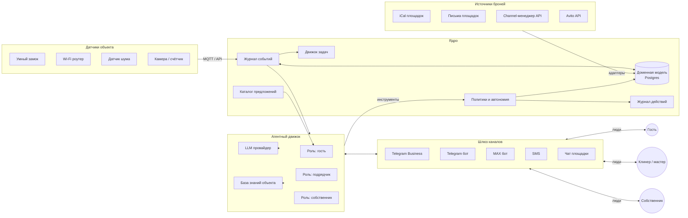

# Pomogaika — архитектура

Черновик v0.1 для обсуждения с командой. Сентябрь 2026.

## 1. Принципы

1. **Ядро с журналом событий.** Все слои читают и пишут одно состояние объекта. Никаких «бот подрядчика знает своё, бот гостя своё».
2. **Детерминизм там, где деньги и доступ.** Брони, календарь, коды от двери, задачи — код и конечные автоматы. LLM только понимает текст и генерирует текст.
3. **Политики как код.** Что агенту можно само, что с подтверждением, что никогда — таблица правил, а не промпт. LLM вызывает инструмент, инструмент проверяет политику.
4. **Один агентный движок, несколько ролей.** Гость, подрядчик, собственник — одна runtime-реализация с разными персонами, инструментами и уровнем автономии.
5. **Каналы через возможности.** Транспорт описывается флагами (пишет первым, окно ответа, идентичность), сценарии строятся под ограничения.
6. **Мультитенантность с первого коммита.** `owner_id` и `property_id` во всех сущностях, знания об объекте — в данных, не в промпте.
7. **Журнал действий.** Каждое действие агента: что, почему, кто разрешил. Основа для доверия, отладки и перевода действий в автопилот по статистике.
8. **Копайлот по умолчанию.** Новый объект стартует в режиме подтверждений; автопилот включается по классам действий на основе журнала.
9. **Провайдер LLM за абстракцией.** Смена провайдера — конфиг, не рефакторинг.

## 2. Общая схема



## 3. Компоненты

### 3.1 Ядро

- **Доменная модель** — см. раздел 4. Postgres, миграции, строгие статусы.
- **Журнал событий** — append-only таблица событий (раздел 5). Всё, что происходит с объектом, — событие. Потребители подписаны через очередь.
- **Политики** — таблица `action_type × property → mode (auto | confirm | never)` плюс условия (например, «выдать код» только при `booking.status = paid` и не раньше чем за 2 часа до заезда). Один модуль, один вход `check(action, context)`.
- **Журнал действий** — каждое действие агента с входными данными, решением политики, кем подтверждено.
- **Движок задач** — конечный автомат задачи подрядчика (раздел 3.5).
- **Каталог предложений** — собственные услуги и партнёрские предложения с правилами показа.

### 3.2 Слой броней

Детерминированный, без LLM. Адаптеры с единым интерфейсом «отдай список броней/блоков объекта»:

- **iCal-адаптер** — опрос экспортов площадок каждые N минут, нормализация, дедупликация по датам при перегенерации UID, детект пересечений. Экспорт сводного календаря на каждую площадку без её собственных событий (защита от петель).
- **Почтовый адаптер** — IMAP, парсинг писем площадок о брони/отмене. Быстрый путь (секунды) и источник данных о госте. iCal — сверка.
- **Channel-менеджер адаптер** — API RealtyCalendar/Bnovo, когда объект подключён через них.
- **Avito API адаптер** — после получения партнёрского доступа.

Часовой пояс объекта хранится явно (Калининград UTC+2, площадки часто считают в МСК). Даты выезда/заезда в один день — не конфликт.

Конфликт броней — сущность `BookingConflict` с расчётом стоимости отмены на каждой площадке и предложением собственнику.

### 3.3 Шлюз каналов

Интерфейс транспорта:

```
Channel {
  id, kind
  can_initiate: bool
  reply_window: duration | null
  identity: bot | personal | phone
  send(conversation, message)
  on_receive(callback)
}
```

Реализации: Telegram Bot API (обычный бот и режим Business через `business_connection_id`), MAX Bot API, SMS-провайдер, Avito Messenger API. Разговор (`Conversation`) привязан к каналу и контрагенту; логика агента от канала не зависит.

### 3.4 Агентный движок

Один цикл: входящее сообщение → контекст (роль, объект, бронь, история, база знаний) → LLM с набором инструментов → вызов инструментов через политики → ответ → журнал.

Роли:

| Роль | Доля LLM | Инструменты | Автономия на старте |
|---|---|---|---|
| Гость | Высокая | `get_booking`, `get_property_info`, `issue_door_code`, `create_incident`, `escalate_to_owner`, `present_offer`, `create_order` | Копайлот: черновик → подтверждение собственника |
| Подрядчик | Низкая | `accept_task`, `reschedule_task`, `complete_task(photos)`, `report_problem` | Автопилот (автомат задач) |
| Собственник | Средняя | `list_bookings`, `block_dates`, `set_price`, `update_knowledge`, `approve_action`, `get_report`, `assign_contractor` | Автопилот с подтверждением опасных действий |

База знаний объекта — структурированные данные (адрес, парковка, Wi-Fi, правила, инструкции заезда, FAQ) с правкой через чат собственника. Не промпт.

Режим копайлота: ответ агента уходит собственнику с кнопками «отправить / править / ответить самому». Статистика подтверждений по классам вопросов → включение автопилота по классу.

### 3.5 Движок задач

Правила контроля подрядчиков, уровни доверия и проверка фото — в [contractors.md](contractors.md).

Состояния: `created → assigned → accepted → in_progress → done | failed | expired`. Таймеры: не принята за N минут → следующий исполнитель → собственник. Приёмка: чек-лист + фото. Типы: `cleaning`, `repair`, `supply`, `inspection`. Создаётся событиями (`stay.checked_out` → `cleaning`) или собственником.

### 3.6 Шлюз датчиков

Источник событий, не слой общения. Замок (API производителя или локальный хаб), роутер (число устройств), датчик шума (уровень, без записи), камера (счётчик пересечений, без распознавания лиц), протечка, электросчётчик. События нормализуются в `sensor.*` и сравниваются с ожиданием: по брони двое — в сети девять устройств; должно быть пусто — замок открылся. Реакция по политике: сначала мягкое сообщение гостю, потом собственнику с собранными данными.

### 3.7 Предложения (апсейл)

Каталог: собственные услуги (поздний выезд, ранний заезд, доп. уборка, парковка) и партнёрские (ссылки/промокоды агрегаторов, локальные партнёры). Правила показа: только в контексте или в фиксированных точках, лимит на проживание, стоп после отказа. Оплата партнёрских услуг — на стороне партнёра. Профиль гостя — теги на время проживания плюс согласие на редкие сообщения после выезда.

### 3.8 Поверхность собственника

Фаза 1–2: только Telegram-бот. Фаза 3: веб-панель (календарь, объекты, роли, отчёты) на том же API.

### 3.9 Аналитика

Материализованные отчёты из журнала событий: загрузка, доход, источники, время ответа, срывы задач, время собственника на бронь, апсейл.

## 4. Модель данных (ключевые сущности)

| Сущность | Ключевые поля |
|---|---|
| `Owner` | id, contacts, billing, settings |
| `Property` | id, owner_id, address, timezone, knowledge (структура), house_rules, max_guests, checkin/checkout times, devices |
| `Listing` | id, property_id, platform, external_id, ical_url, sync settings |
| `Booking` | id, property_id, listing_id, external_id, source, guest_id, check_in, check_out, guests_count, amount, status (`pending / confirmed / paid / cancelled`), raw |
| `Block` | id, property_id, dates, reason |
| `BookingConflict` | id, booking_ids, detected_at, resolution, cost estimate |
| `Stay` | id, booking_id, door_code, checked_in_at, checked_out_at, status |
| `Guest` | id, name, phone, channel_ids, tags (на время проживания), consents |
| `Conversation` / `Message` | id, channel, counterpart (guest/contractor/owner), property_id, direction, text, attachments, agent_draft, approved_by |
| `Contractor` | id, owner_id, type, channel_ids, availability |
| `Task` | id, property_id, type, stay_id, state, assignee, deadline, checklist, proofs |
| `Device` / `SensorEvent` | id, property_id, kind, payload, ts |
| `Offer` / `Order` | id, property_id, type, price, partner, rules; order status, payment side |
| `Policy` | property_id, action_type, mode, conditions |
| `Event` | id, property_id, type, payload, ts, causation_id |
| `AuditLog` | id, actor (agent role / human), action, input, policy_decision, approved_by, ts |

### 4.1 Масштабирование: много объектов и много собственников

Принцип 6 требует мультитенантности с первого коммита. Схема ему соответствует (`owner_id` у `Property`, `property_id` у остальных), а код на пилоте — нет: объект добывается через `session.query(Property).one()`, и второй объект роняет запрос.

Три уровня, которые нужно пройти. Первый сделан.

**Уровень 1. Много объектов у одного собственника — сделано.**

- `build_miniapp(session, *, year, month, owner_id=None, property_id=None)` работает со списком объектов; занятость считается по каждому объекту отдельно, иначе «занято» одного закрывало бы календарь другого.
- В ответе есть `objects[]` с загрузкой и массивом свободных ночей; у каждой брони, блока, задачи, черновика и конфликта проставлен `property_id`.
- Шахматка рисует строку на объект; пересекающиеся полосы внутри строки раскладываются по дорожкам — так видно зеркала одной брони с разных площадок и овербукинг.
- Действия, меняющие данные, требуют объект явно: `POST /api/blocks` принимает `property_id`, а при нескольких объектах без него отвечает 400.

**Уровень 2. Много собственников — не сделано, блокирует продажу сервиса.**

- Аутентификации нет вообще: `/api/*` открыт, любой запрос видит все объекты в базе. Для мини-аппа естественный механизм — проверка подписи `initData` Telegram и резолв `owner_id` по `telegram_user_id`; для бота — тот же резолв вместо `TELEGRAM_OWNER_USER_ID` из `.env`.
- Собственник определяется глобально: `_is_owner()` сверяет id с переменной окружения, `session.query(Owner).first()` берёт первого. Обе точки должны стать «собственник этого объекта».
- Скоуп по `owner_id` нужен в каждом запросе чтения и записи, а не только в мини-аппе: `drafts.py`, `ops.py`, `watch.py`, `cleaner.py`, десять мест в `bots/telegram.py`.
- `Contractor`, `ChecklistItem`, `Event` объявлены с `property_id = 1` по умолчанию и без внешнего ключа — дефолт надо убрать, ключ поставить.
- Один бот на всех собственников: `business_connection_id` уже хранится в `TelegramLink`, но запись одна (`kind="business"`), нужна связь «собственник → подключение».

**Уровень 3. Объём.**

- SQLite и `Base.metadata.create_all` — до фазы 2; дальше Postgres и миграции (Alembic), как в §8.
- Мини-апп сейчас получает все объекты одним ответом. До нескольких десятков это дешевле пагинации; дальше — окно по датам и постраничные брони.
- Синхронизация iCal идёт по всем объявлениям подряд; на объёме нужна очередь с приоритетом по ближайшим заездам.
- Индексы: `(property_id, check_in)` у `Booking`, `(property_id, status)` у `MessageDraft` и `Task`.

## 5. События (первый список)

- Брони: `booking.created`, `booking.updated`, `booking.cancelled`, `booking.paid`, `booking.conflict_detected`, `booking.conflict_resolved`
- Проживание: `stay.checkin_window_opened`, `stay.code_issued`, `stay.checked_in`, `stay.checkout_due`, `stay.checked_out`, `stay.overstay`
- Сообщения: `message.received`, `message.draft_created`, `message.sent`, `escalation.raised`, `escalation.resolved`
- Задачи: `task.created`, `task.assigned`, `task.accepted`, `task.started`, `task.completed`, `task.overdue`, `task.failed`
- Датчики: `sensor.door_opened`, `sensor.occupancy_mismatch`, `sensor.noise_threshold`, `sensor.presence_when_vacant`, `sensor.leak`
- Предложения: `offer.presented`, `offer.declined`, `order.created`, `order.completed`
- Календарь: `calendar.synced`, `calendar.sync_failed`, `calendar.stale`

## 6. Политики и уровни автономии

| Действие | Старт | Условия | Кто может перевести в auto |
|---|---|---|---|
| Ответ на типовой вопрос гостя | confirm | класс вопроса из белого списка | Собственник, по статистике подтверждений |
| Выдать код от двери | confirm → auto | `booking.paid`, не раньше 2 ч до заезда, не позже выезда | Собственник |
| Обещать возврат/скидку | never | — | — |
| Создать задачу клинеру по выезду | auto | — | — |
| Написать гостю про лишних людей | confirm | `occupancy_mismatch` выше порога | Собственник |
| Закрыть даты на площадках | auto | — | — |
| Отменить бронь | never (только человек) | — | — |
| Показать предложение | auto с лимитом | контекст или точка касания, лимит на проживание | — |

## 7. Ключевые сценарии

1. **Новая бронь.** Письмо площадки → `booking.created` → закрытие дат на других площадках → детект конфликта → приветствие гостю по каналу площадки/SMS со ссылкой на мессенджер → уведомление собственнику.
2. **Заезд.** `stay.checkin_window_opened` → политика проверяет оплату → код гостю (копайлот/авто) → замок фиксирует `stay.checked_in` → счётчик Wi-Fi сравнивается с `guests_count`.
3. **Вопрос гостя.** Сообщение → агент с базой знаний → черновик → подтверждение собственника (или авто по классу) → ответ → журнал.
4. **Выезд и уборка.** `stay.checked_out` по замку или по времени → `task.created(cleaning)` → клинер принимает → фото-чек-лист → `task.completed` → собственнику сводка; срыв → следующий клинер → собственник.
5. **Конфликт броней.** `booking.conflict_detected` → расчёт стоимости отмены на каждой площадке → собственнику варианты одной кнопкой → черновики писем гостям.
6. **Лишние гости.** `sensor.occupancy_mismatch` → мягкое сообщение гостю → если не решилось за N часов или порог шума → собственнику с данными.

## 8. Технологический стек (предложение к обсуждению)

- Backend: Python 3.12 (FastAPI, SQLAlchemy, Alembic) или TypeScript (NestJS). Выбираем по команде.
- Хранилище: Postgres; Redis для очередей/таймеров (или простая таблица outbox + воркер на старте).
- Telegram: aiogram / grammY. MAX: официальный Bot API. SMS: любой провайдер с API.
- LLM: абстракция провайдера; кандидаты — Claude/OpenAI через доступный шлюз и YandexGPT/GigaChat для контента с персональными данными (см. раздел 10). Инструменты через нативный tool use.
- Датчики: MQTT-брокер, Home Assistant как опциональный хаб, Frigate для камеры.
- Хостинг: VPS в РФ, Docker Compose на старте.
- Наблюдаемость: структурные логи, трассировка вызовов LLM, дашборд журнала действий.

## 9. Первые итерации (срезы MVP)

1. Ядро + iCal + почтовый адаптер + бот собственника с уведомлениями о бронях и конфликтах.
2. База знаний объекта + гостевой агент в копайлоте через Telegram Business.
3. Задачи клинеру + бот подрядчика.
4. Замок: коды на бронь, события заезда/выезда.
5. Wi-Fi-счётчик и политика «лишние люди».
6. Автопилот по классам вопросов, апсейл своих услуг.
7. Мультитенантный онбординг + биллинг.

## 10. Безопасность и данные

- Персональные данные гостей: минимизация, сроки хранения, согласие в правилах проживания, уведомление РКН при необходимости.
- Передача ПДн в зарубежный LLM — трансграничная передача. Варианты: обезличивание перед вызовом (имя/телефон заменяются токенами), российский провайдер для текстов с ПДн, гибрид. Решить до фазы 2.
- Коды от двери: одноразовые на бронь, не хранятся в открытом виде в переписке дольше необходимого.
- Сессии чужих аккаунтов не храним (нет юзерботов). Токены ботов и API — в секрет-хранилище.
- Камера: без распознавания лиц, с раскрытием, ограниченный срок хранения записей.
- Журнал действий неизменяем.

## 11. Чего сознательно не делаем

- Юзерботы и автоматизация личных аккаунтов (Telegram MTProto для чужих аккаунтов, любой MAX-клиент).
- Computer use поверх мессенджеров.
- Собственные партнёрские интеграции с площадками до объёма 30–50 объектов (кроме заявки на Avito API).
- Распознавание лиц.
- Веб-панель до фазы 3.
- Динамическое ценообразование как функция (только сбор данных).

## 12. Открытые технические вопросы

1. Язык/фреймворк backend — по составу команды.
2. Провайдер LLM и стратегия для ПДн (раздел 10).
3. Какой умный замок: TTLock-совместимые, Aqara/Zigbee через локальный хаб, отечественные. Критерии: API, коды с ограничением по времени, журнал открытий, работа без облака.
4. Роутер с API для счётчика устройств (Keenetic, MikroTik) — требование к объекту или опция.
5. Формат хранения базы знаний: структурированная схема + свободные FAQ, как версионируем.
6. Очередь событий: Redis Streams / RabbitMQ / таблица outbox на старте.
7. Как мерить качество ответов агента: набор эталонных диалогов из фазы 0, регресс при смене модели/промпта.
8. Что считаем «классом вопроса» для автопилота и как его классифицируем.
